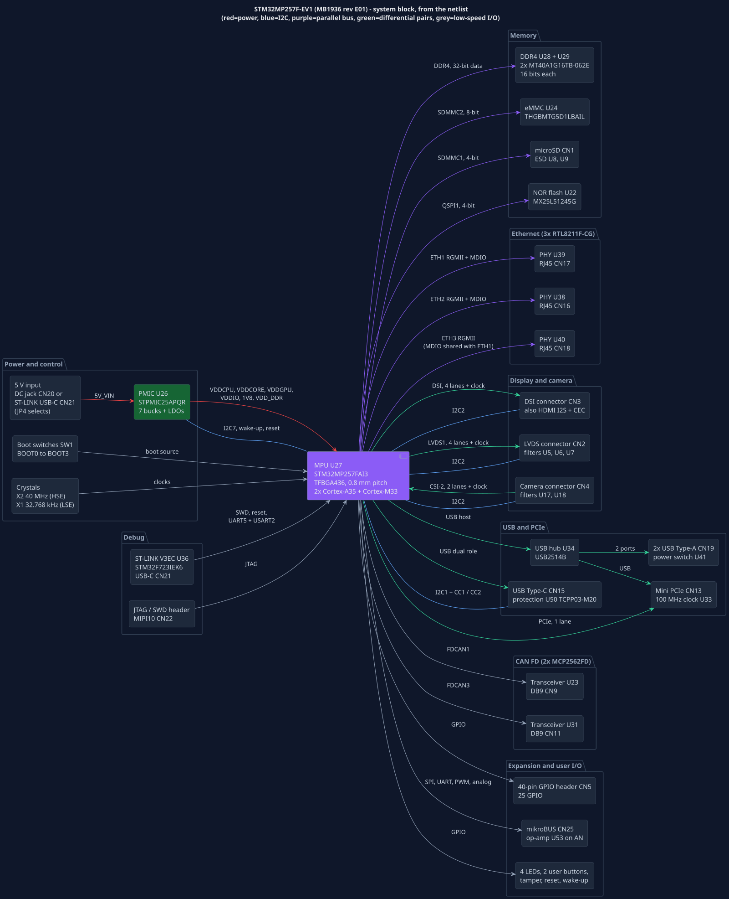

# Custom Linux SoM - Yocto BSP

Firmware and Linux BSP for a custom System-on-Module (SoM) with castellated pads and its carrier board.

The SoM and carrier are designed in-house. This repo holds the firmware side: Yocto layer, bootloader, kernel and device tree, plus demo apps for 3D graphics, display and camera.

> Hardware design files (schematics, layout) are private. Block diagrams, pin maps and bring-up notes are shared in [`docs/05-hardware`](docs/05-hardware). Design files are available on request.

## Target features

| Function | Target |
|---|---|
| CPU | STM32MP257F: dual Cortex-A35 at 1.5 GHz plus Cortex-M33, embedded Linux (Yocto) |
| Graphics | 3D GPU, OpenGL ES 3.1 / Vulkan |
| Display | MIPI DSI (4-lane), with touch |
| Camera | MIPI CSI-2 (2-lane) with ISP |
| Storage | eMMC on SoM, microSD on carrier |
| Network | Gigabit Ethernet (PHY on SoM) |
| I/O | GPIO, I2C, SPI, UART, CAN for peripherals |
| Module | Castellated pads, single 5 V input, PMIC on SoM |

## Status

- [x] SoC selection: STM32MP257F (`STM32MP257FAI3`, TFBGA436, 0.8 mm pitch)
- [ ] Pad map (SoM to carrier)
- [ ] SoM and carrier design
- [ ] Board bring-up (power, DDR, first boot)
- [ ] Yocto BSP (U-Boot, kernel, device tree)
- [ ] Display, camera and 3D demos

## Reference design

The SoM starts from ST's STM32MP257F-EV1 evaluation board, which uses the same SoC in the same package. This is the block diagram of that board, built from its netlist. It is not our SoM yet.



Buses, power tree and notes per block: [`docs/05-hardware/ev1-reference-block-diagram.md`](docs/05-hardware/ev1-reference-block-diagram.md).

## SoC candidates

Selected: **STM32MP257**. The others are kept here for the record.

| SoC | 3D GPU | Display | Camera | Notes |
|---|---|---|---|---|
| TI AM62x | PowerVR AXE-1-16M, GLES 3.1 | RGB, LVDS | CSI-2 4-lane | 0.8 mm pitch, also as Octavo OSD62x SiP |
| TI AM62P | PowerVR, about 3x AM62x | DSI, LVDS, RGB | CSI-2 | 32-bit LPDDR4 |
| STM32MP257 | GLES 3.1, Vulkan 1.3 | DSI, LVDS, RGB | CSI-2 with ISP | 0.8 mm pitch, NPU |
| Rockchip RK3566 | Mali-G52, GLES 3.2 | DSI, RGB, LVDS, HDMI | CSI-2 with ISP | Low cost |
| NXP i.MX 8M Plus | GC7000UL, GLES 3.1 | DSI, LVDS, HDMI | 2x CSI with ISP | 0.5 mm pitch, NPU |

Full comparison, the reasons for the choice and the ST reference designs: [`docs/05-hardware/soc-selection.md`](docs/05-hardware/soc-selection.md).

## Repo layout

```
docs/             Numbered docs: requirements, architecture, hardware, testing, ...
meta-custom-som/  Yocto layer: machine config, U-Boot, kernel and device tree, GPU, camera, images
apps/             3D, display and camera demo apps
scripts/          Build, flash and bring-up helper scripts
```

## Roles

- Firmware, BSP, SoC selection, pin mapping and bring-up: [@bdcabreran](https://github.com/bdcabreran)
- Schematics and PCB layout: (HW engineer)
