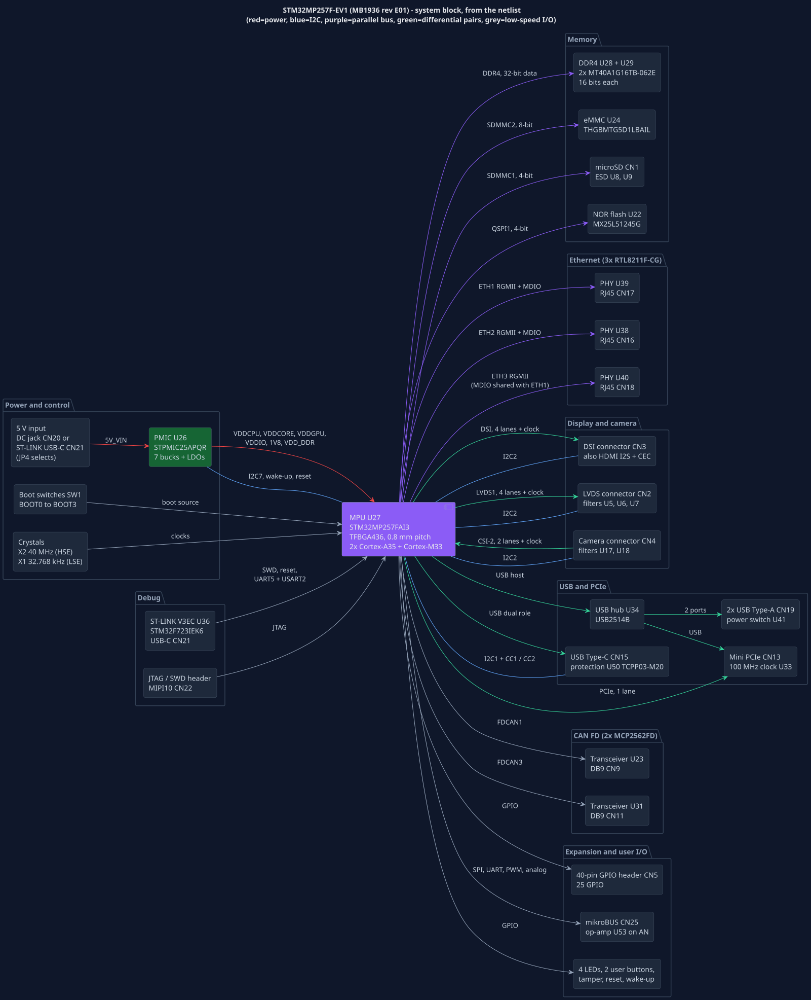
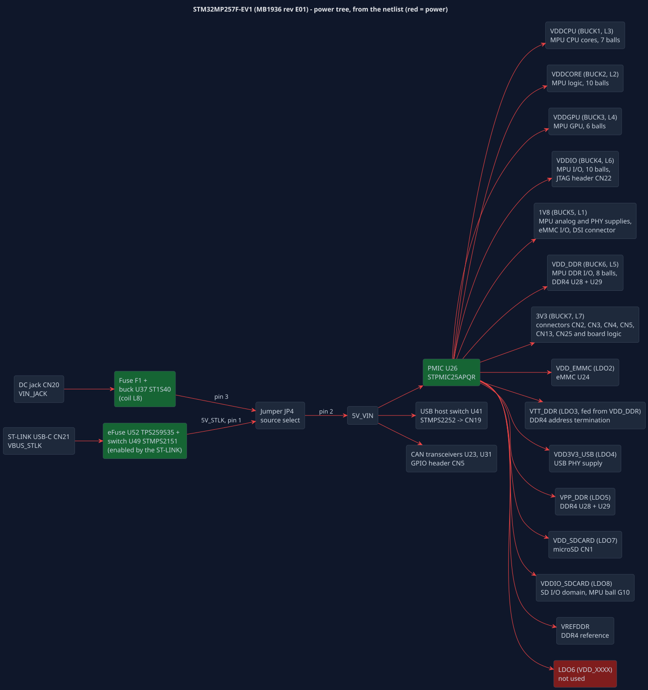

# STM32MP257F-EV1 reference board - block diagram

This is the block-level map of ST's evaluation board, not of our SoM. We start the SoM design from
this board because it uses the same SoC in the same package. Our own board gets its own
`hardware-block-diagram.md` when the schematic exists.

| Field | Value |
|---|---|
| Board | STM32MP257F-EV1, main board MB1936, revision E01 |
| Read from | `docs/08-references/ev1-mb1936/mb1936-e01-netlist.txt` (673 nets, 852 parts, 3452 pins) |
| Netlist source | ST manufacturing files 3.0, ODB++ data dated 28 Nov 2025 |
| Cross-checked with | ST user manual UM3359 and application notes AN5489, AN6115 (for voltages and PMIC pin names) |
| Read on | 2026-11-23 |

Part numbers, reference designators, net names and ball numbers come from the netlist. Voltages do
not: a netlist has none, so each voltage below names the ST document it comes from.

## At a glance

| Block | What is on the board |
|---|---|
| Processor | `STM32MP257FAI3` (U27), TFBGA436, 0.8 mm pitch, 436 balls |
| Power input | 5 V on `5V_VIN`, from the DC jack (CN20) or the ST-LINK USB-C (CN21), selected by jumper JP4 |
| PMIC | `STPMIC25APQR` (U26), 7 bucks and 8 LDOs, controlled over I2C7 |
| RAM | 2x `MT40A1G16TB-062E` DDR4 (U28, U29), 16 data bits each |
| Storage | eMMC `THGBMTG5D1LBAIL` (U24), microSD (CN1), NOR flash `MX25L51245G` (U22) |
| Ethernet | 3x `RTL8211F-CG` RGMII PHY (U38, U39, U40) with RJ45 CN16, CN17, CN18 |
| Display | DSI connector CN3 (4 lanes), LVDS connector CN2 (4 lanes) |
| Camera | CSI-2 connector CN4 (2 lanes) |
| USB | Hub `USB2514B` (U34) to 2x Type-A (CN19), Type-C dual role (CN15) with `TCPP03-M20` (U50) |
| PCIe | Mini PCIe CN13, 1 lane, 100 MHz clock generator `DSC557` (U33) |
| CAN FD | 2x `MCP2562FD` (U23, U31) on FDCAN1 and FDCAN3, DB9 CN9 and CN11 |
| Debug | ST-LINK V3EC (U36, `STM32F723IEK6`), MIPI10 JTAG header CN22 |

## System block diagram

Edge colors: red is power, blue is I2C, purple is a parallel bus (DDR, RGMII, SDMMC, QSPI), green is
differential pairs (DSI, LVDS, CSI-2, USB, PCIe), grey is low-speed I/O (GPIO, UART, CAN, JTAG).

## Buses

| Bus | MPU side | Devices |
|---|---|---|
| DDR4 | `DDR_DQ0..31`, `DDR_A0..13`, clock on N19 / M19 | U29 holds DQ0-15, U28 holds DQ16-31. Address and control go to both chips |
| SDMMC1 | 4-bit, `SD.SDMMC1_*` | microSD CN1, through ESD parts U8 and U9 |
| SDMMC2 | 8-bit, `eMMC.SDMMC2_*` | eMMC U24 |
| QSPI1 | 4 data lines, `QSPI1.*` | NOR flash U22 |
| ETH1 RGMII | `ETH1.*`, with MDIO on V10 / V12 | PHY U39 to CN17. The same MDIO bus also reaches PHY U40 |
| ETH2 RGMII | `ETH2.*`, with its own MDIO on U9 / AA10 | PHY U38 to CN16 |
| ETH3 RGMII | `ETH3.*`, no MDIO of its own | PHY U40 to CN18 |
| DSI | 4 data lanes and clock, `DSI.*` | CN3, direct, no filter |
| LVDS1 | 4 data lanes and clock, `LVDS1.*` | CN2, through filters U5, U6, U7 |
| CSI-2 | 2 data lanes and clock, `CSI.*` | CN4, through filters U17, U18 |
| I2C2 | B11 (SCL), D10 (SDA) | Shared by CN2, CN3, CN4 and CN5 |
| I2C7 | F16 (SCL), G15 (SDA) | PMIC U26 only |
| I2C1 | K5 (SCL), H6 (SDA) | USB Type-C protection U50 |
| USB host | `USBH_P/N` on AA16 / AB16 | Hub U34, then CN19 and the mini PCIe slot |
| USB dual role | `USBDR_P/N` on W17 / Y17 | Type-C CN15, through filter U42 |
| PCIe | 1 lane, `PCIE.*` | Mini PCIe CN13 |
| FDCAN1, FDCAN3 | J4 / J3 and L3 / G1 | Transceivers U23 and U31 |
| UART5, USART2 | G3 / H3 and Y15 / W15 | ST-LINK virtual COM ports, through series resistors |

I2C addresses are not in a netlist, so none are listed.

## Power

The 5 V input comes from one of two sources, selected by JP4. The DC jack goes through fuse F1 and
the buck U37 (`ST1S40`). The ST-LINK USB-C goes through the eFuse U52 and the switch U49. Each buck
output has a current-sense net (`I_SENS_*`) for power measurement.

| Rail | Source | Feeds | Voltage (source) |
|---|---|---|---|
| `5V_VIN` | JP4 | PMIC, USB host switch U41, CAN transceivers, CN5 | 5 V (UM3359) |
| `VDDCPU` | BUCK1, coil L3 | MPU, 7 balls | 0.8 or 0.9 V (AN5489) |
| `VDDCORE` | BUCK2, coil L2 | MPU, 10 balls | 0.82 V (AN5489) |
| `VDDGPU` | BUCK3, coil L4 | MPU, 6 balls | 0.8 or 0.9 V (AN5489) |
| `VDDIO` | BUCK4, coil L6 | MPU I/O (10 balls), PMIC VIO, CN22 | 3.3 V (AN5489) |
| `1V8` | BUCK5, coil L1 | MPU (10 balls), eMMC U24, CN3 | 1.8 V (AN5489) |
| `VDD_DDR` | BUCK6, coil L5 | MPU (8 balls), DDR4 U28 and U29, input of LDO3 | 1.2 V (AN5489) |
| `3V3` | BUCK7, coil L7 | CN2, CN3, CN4, CN5, CN13, CN25 and board logic | 3.3 V (net name) |
| `VDD_EMMC` | LDO2 | eMMC U24 | 3.3 V (UM3359) |
| `VTT_DDR` | LDO3 | DDR4 address termination resistors | 0.6 V (UM3359) |
| `VDD3V3_USB` | LDO4 | USB PHY supply | 3.3 V (UM3359) |
| `VPP_DDR` | LDO5 | DDR4 U28 and U29 | 2.5 V (UM3359) |
| `VDD_XXXX` | LDO6 | Nothing, not used | - |
| `VDD_SDCARD` | LDO7 | microSD CN1 | 3.3 V (UM3359) |
| `VDDIO_SDCARD` | LDO8 | SD I/O domain, MPU ball G10, SD pull-ups | 3.3 V or 1.8 V (UM3359) |

## 1. Processor

`STM32MP257FAI3` (U27). The clocks are a 40 MHz crystal X2 on HSE and a 32.768 kHz crystal X1 on LSE.
The boot source is set by the four switches of SW1 on `BOOT0` to `BOOT3` (balls R4, R3, T2, T1).
`NRST` is on U3 and goes to the reset button, the JTAG header and the ST-LINK.

## 2. Memory

Two 16-bit DDR4 chips give the 32-bit bus. Address and control lines go to both chips and each has a
series resistor network to `VTT_DDR`. The clock pair has a 100 ohm resistor (R270) across it. Data
lines are point to point.

The eMMC is on SDMMC2 with 8 data lines, the microSD on SDMMC1 with 4. The SD I/O voltage has its own
PMIC LDO so it can switch between 3.3 V and 1.8 V.

## 3. Ethernet

Three identical PHYs, each with its own 25 MHz crystal (X4, X5, X6). There are only two MDIO buses:
ETH1 and ETH3 share one, ETH2 has its own. `ETH1.NRST` (M1) resets U39 and U40 together, `ETH2.NRST`
(H2) resets U38. Every RGMII line has a series resistor.

## 4. Display and camera

DSI goes straight to connector CN3, which also carries I2S and CEC for ST's HDMI adapter board. LVDS
and CSI-2 go through common-mode filters. The camera connector also carries `CAM_ENABLE` (G5),
`CAM_RESET` (L6) and four interrupt lines for an IMU and a time-of-flight sensor.

## 5. USB and PCIe

The host port feeds a 4-port hub. Two ports go to the Type-A connector, with VBUS switched by U41,
and one goes to the mini PCIe slot. The dual-role port goes to the Type-C connector CN15, with U50
handling the CC lines and protection.

## 6. CAN FD

FDCAN1 and FDCAN3 each have a transceiver with a standby pin (`FDCAN1.STBY` on M4, `FDCAN3.STBY` on
K2) and an ESD part (U25, U32). FDCAN2 is not used.

## 7. Debug

The on-board ST-LINK gives SWD and two virtual COM ports over USB-C. The MIPI10 header CN22 carries
full JTAG for an external probe.

## 8. Expansion and user I/O

The 40-pin header CN5 carries 25 GPIO. The mikroBUS socket CN25 has SPI, UART, PWM, interrupt, reset
and an analog input buffered by the op-amp U53. There are four LEDs and five buttons (two user,
tamper, reset, wake-up).

## What this means for our SoM

| EV1 block | Our plan |
|---|---|
| MPU, PMIC, DDR4, eMMC, crystals | On the SoM. Copy from the EV1 first |
| One Ethernet PHY | On the SoM, MDI pairs go to the pads |
| DSI, CSI-2, SD, USB, CAN, UART, I2C, GPIO | Signals go to the pads, connectors sit on the carrier |
| Second and third PHY, LVDS, PCIe, NOR, ST-LINK | Not planned. To be confirmed in the pad map |

## Open items

- LDO1 of the PMIC (pin 14) drives an unnamed net (`NetC66_2`, 3 pins). Its use is not clear from the
  netlist. Check sheet 4 of the schematic.
- The netlist is derived from the ODB++ data, not exported from Altium. It passed a spot check but
  was not compared line by line.
- Buck voltages are the AN5489 example values for a 3.3 V I/O and DDR4 design, not read from this
  board. Confirm them on sheet 4 of the schematic before using them.
- I2C addresses and pull-up values are not listed here.

## Component references

- STM32MP257F datasheet (DS14284): https://www.st.com/resource/en/datasheet/stm32mp257f.pdf
- STPMIC25 datasheet (DS14278): https://www.st.com/resource/en/datasheet/stpmic25.pdf
- EV1 user manual (UM3359): https://www.st.com/resource/en/user_manual/um3359-evaluation-board-with-stm32mp257f-mpu-stmicroelectronics.pdf
- Other parts, no link recorded yet: `MT40A1G16TB-062E` (Micron), `THGBMTG5D1LBAIL` (Kioxia),
  `MX25L51245G` (Macronix), `RTL8211F-CG` (Realtek), `USB2514B` and `MCP2562FD` (Microchip).
