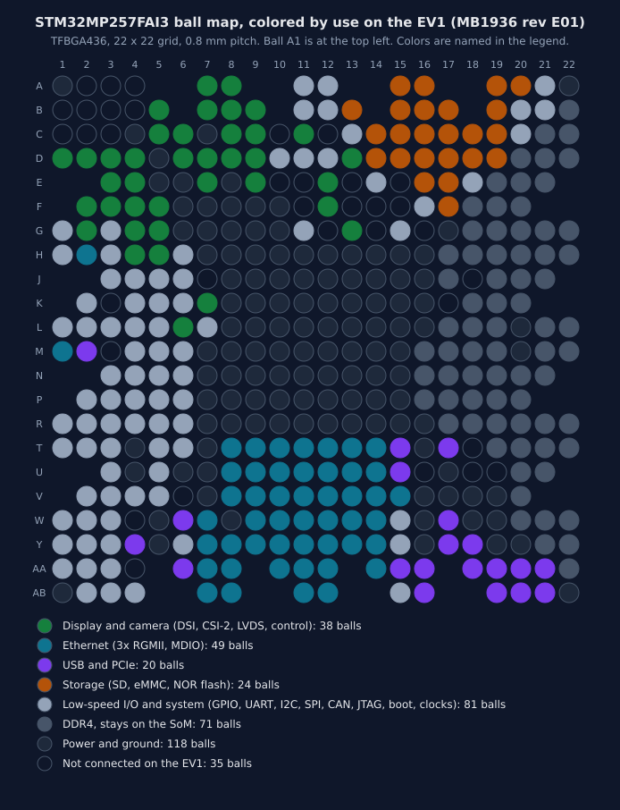
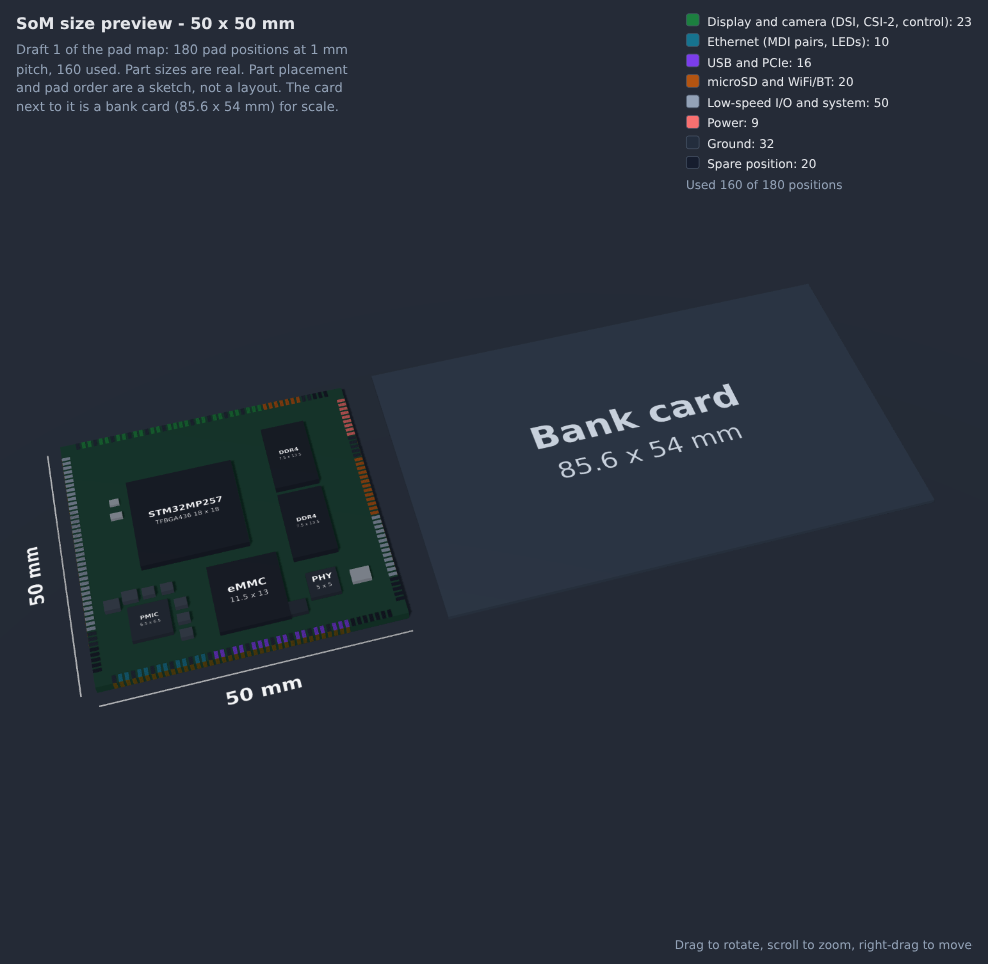

# SoM pad map - draft 1

The pad map is the list of signals that cross from the SoM to the carrier board through the
castellated pads. It is the contract between the two boards: the HW engineer routes to it, and the
device tree is written against it. This first draft covers the interfaces we agreed are fixed (PCIe,
camera, display, Ethernet, USB) plus the recommended low-speed set. It comes to 160 pads.

> Status: draft for discussion, 2026-11-23. Nothing is routed. Pad numbers are not assigned yet, only
> groups and counts. MPU ball numbers are the ones ST uses on the EV1, read from
> `docs/08-references/ev1-mb1936/mb1936-e01-netlist.txt`.

One rule drives the ball choices: where the EV1 already has a function, the SoM uses the same balls,
because then ST's EV1 device tree and schematic sheets carry over with small changes.

## Where the signals leave the chip

Each interface sits in one area of the package, so each one has a natural module edge. The map is
drawn with ball A1 at the top left. Check that against the package drawing in DS14284 before
placement: if that drawing is a bottom view, the map is mirrored left to right.

| Module edge | Why | Goes there | Pads |
|---|---|---|---|
| North | Display, camera and SD balls are in rows A to G | DSI, CSI-2, their control lines, microSD | 42 |
| South | Ethernet, USB and PCIe balls are in rows T to AB | Ethernet MDI, USB, PCIe | 38 |
| West | Low-speed I/O balls are in columns 1 to 6 | System, debug, UART, I2C, SPI, CAN | 40 |
| East | The DDR4 chips sit on this side, so only signals that can take a long route go here | Power, WiFi/BT, audio, PWM, ADC | 40 |

## The numbers

| Item | Pads |
|---|---|
| Signals | 119 |
| Power | 9 |
| Ground | 32 |
| Total | 160 |

Ground is 20 % of the total, which is the share set in `soc-selection.md`. Of the 32 ground pads,
22 sit between differential pairs (one on each side of every pair) and 10 are power returns.

At 1 mm pad pitch, a 50 mm square module with 2.5 mm kept clear at each corner has 45 positions per
side, 180 in total. That leaves 20 spare. The corner clearance is an assumption, not a measured
value. The earlier rough budget in `soc-selection.md` was 130 to 150 pads, so this draft is 10 over
its top end.

This is what that module looks like next to a bank card. The part sizes are real, but the placement
and the pad order along each edge are a sketch, not a layout. Open
`diagrams/som-pad-map/som-3d-preview.html` in a browser to rotate it.

In this sketch the main parts fit on a 50 mm board with room left, so the pad count is what sets the
size. The passives are not drawn, and there are a few hundred of them on the EV1.

## High-speed interfaces

| Interface | Signals | Pads | MPU balls on the EV1 | Notes |
|---|---|---|---|---|
| PCIe, 1 lane | TX pair, RX pair, 100 MHz clock pair, CLKREQ, PERST, WAKE | 9 | TX AA19 / AB19, RX AA20 / AB20, CLKREQ U15, PERST M2, WAKE AA15 | TX coupling capacitors stay on the SoM. The clock generator stays on the SoM too, as on the EV1 (U33), and sends one clock pair to the pads |
| DSI, 4 lanes | Clock pair, 4 data pairs | 10 | Clock A8 / B8, D0 C9 / B9, D1 D9 / E9, D2 C8 / D8, D3 A7 / B7 | Direct, no filter, as on the EV1 |
| Display control | Reset, backlight PWM, tearing effect, touch interrupt | 4 | G4, H5, K7, D13 | Touch and panel share I2C2 |
| CSI-2, 2 lanes | Clock pair, 2 data pairs | 6 | Clock C6 / D6, D0 C5 / B5, D1 D7 / E7 | The EV1 puts a common-mode filter on each pair. Put it on the carrier, next to the connector |
| Camera control | Enable, reset, sensor clock | 3 | Enable G5, reset L6, clock not on the EV1 | Camera shares I2C2 |
| Ethernet, 1 port | 4 MDI pairs, 2 LED lines | 10 | None, the pads come from the PHY | The PHY and its 25 MHz crystal are on the SoM. Only the analog pairs cross, because RGMII would cost 14 pads and needs length matching across the pads. Magnetics go on the carrier |
| USB host | 1 pair, VBUS enable, over-current | 4 | Pair AA16 / AB16 | USB 2.0 |
| USB dual role | 1 pair, VBUS detect | 3 | Pair W17 / Y17, detect AA6 | USB 2.0 |

Both USB ports are USB 2.0, because the chip has one 5 Gbit/s PHY and PCIe uses it.

## Storage and wireless

| Interface | Signals | Pads | MPU balls on the EV1 | Notes |
|---|---|---|---|---|
| microSD | Clock, command, 4 data, card detect | 7 | CK D16, CMD C16, D0 B17, D1 C17, D2 A16, D3 B16, detect B13 | SDMMC1. The 3.3 V / 1.8 V switch of the I/O rail stays on the SoM (PMIC LDO8) |
| WiFi SDIO | Clock, command, 4 data | 6 | Not on the EV1 | SDMMC3. Balls to assign |
| Bluetooth UART | TX, RX, RTS, CTS | 4 | Not on the EV1 | Balls to assign |
| Wireless control | WiFi enable, Bluetooth enable, wake | 3 | Not on the EV1 | Balls to assign |

The eMMC stays on the SoM on SDMMC2 and does not use pads.

## Low-speed interfaces

| Interface | Signals | Pads | MPU balls on the EV1 | Notes |
|---|---|---|---|---|
| UART A, 4-wire | TX, RX, RTS, CTS | 4 | TX G3, RX H3 (UART5) | RTS and CTS balls to assign |
| UART B, 2-wire | TX, RX | 2 | TX P2, RX P3 | The mikroBUS UART on the EV1 |
| I2C A | SCL, SDA | 2 | B11, D10 (I2C2) | Shared with the display, touch and camera |
| I2C B | SCL, SDA | 2 | N4, R5 | The pair the EV1 sends to the 40-pin header and the mikroBUS socket. Confirm it is an I2C there |
| SPI A | SCK, MISO, MOSI, CS | 4 | P4, N6, N5, R6 | The mikroBUS SPI on the EV1 |
| SPI B | SCK, MISO, MOSI, CS | 4 | Not on the EV1 | Balls to assign |
| CAN FD x2 | TX, RX each | 4 | FDCAN1 J4 / J3, FDCAN3 L3 / G1 | Transceivers go on the carrier |
| Audio, 1 SAI | Bit clock, frame sync, data out, data in, master clock | 5 | Not on the EV1 as a full SAI | Balls to assign |
| PWM x4 | 1 line each | 4 | One on AB4 | Three balls to assign |
| ADC x4 | 1 line each | 4 | One on V5 | Three balls to assign |

## System and power

| Group | Signals | Pads | MPU balls on the EV1 | Notes |
|---|---|---|---|---|
| Reset and wake | Reset, power key, wake-up | 3 | Reset U3, wake-up P6 | The power key goes to the PMIC |
| Boot mode | BOOT0 to BOOT3 | 4 | R4, R3, T2, T1 | Default set on the SoM for eMMC boot. The carrier can override it for SD boot and USB flashing |
| Carrier power enable | 1 line | 1 | From the PMIC | Tells the carrier its rails may turn on, so it never back-feeds the SoM |
| JTAG / SWD | SWCLK, SWDIO, TDO, TDI, TRST | 5 | AA1, Y1, W1, AB2, AA2 | |
| Debug UART | TX, RX | 2 | TX Y15, RX W15 (USART2) | Goes to the ST-LINK virtual COM port on the EV1. Confirm in the EV1 device tree that it is the console |
| 5 V input | 4 pads | 4 | - | The only supply into the SoM |
| 3.3 V output | 2 pads | 2 | - | For carrier logic, from the PMIC |
| 1.8 V output | 1 pad | 1 | - | Reference for level shifters |
| SD card supply | 1 pad | 1 | - | PMIC LDO7, so the SoM can power-cycle the card |
| RTC backup | VBAT | 1 | P7 | |

## What it cannot do

- No USB 3.0. It would take the PHY that PCIe uses.
- One Ethernet port. A second one costs 10 more pads and a second PHY on the SoM.
- No LVDS and no parallel RGB display. LVDS costs 10 pads per link, RGB costs 28.
- The camera is 2 lanes, up to 5 megapixels at 30 frames per second (DS14284).
- No general-purpose GPIO pads beyond the control lines listed. See the open decisions.

## Decisions still open

- PCIe through castellated pads at 5 Gbit/s. `soc-selection.md` says to keep PCIe off the
  castellations or use LGA pads for it, but that note is conservative: other modules do it. The
  Ka-Ro QSMP-25 (STM32MP255, the same PHY) carries the PCIe pairs on 1 mm pitch edge pads, and
  RK3568 stamp-hole modules from Thinkcore and Rongpin carry PCIe on 1 mm pitch castellations. It is
  still the fastest signal on the module, so the HW engineer should confirm the pad and via geometry.
- PCIe socket on the carrier. The goal is to try different modules (NVMe, WiFi, AI accelerators), so
  the suggestion is the simplest option: one M.2 key M socket wired straight to the lane, with no mux
  and no switch chip. Other module types go in through a passive M.2 adapter. This does not change
  the SoM pads, but the M.2 3.3 V supply must come from a regulator on the carrier, not from the SoM
  3.3 V output, because a module can draw 2 A or more.
- Which Ethernet MAC. I suggest ETH2, because on the EV1 it has its own MDIO bus and its own PHY
  (U38), so that sheet copies cleanly. ETH1 and ETH3 share one MDIO bus there.
- I/O voltage of the low-speed pads, 3.3 V or 1.8 V. It follows the STPMIC25 variant.
- Spare GPIO. The agreed list has none. I suggest 8, which fits in the 20 spare positions.
- The 3.3 V and 1.8 V outputs, their current limits and the carrier power enable line. They are a
  proposal, not yet agreed.
- USB dual role on a Type-C connector needs the CC lines (balls T15 / T17 on the EV1). They are not
  in this draft because USB-C power delivery was left for later.
- Balls for the signals marked "to assign". Do it in STM32CubeMX so pin conflicts show up early.
- Module size and pad pitch. The count assumes 50 mm square and 1 mm pitch.

## Changing this later

Adding a signal after layout starts moves pads on one edge, so settle the open decisions first. In
this draft the North edge has 3 spare positions, the South edge 7, West and East 5 each. A new differential pair
costs 3 pads, the pair plus one ground.

A signal that moves to a different ball changes the device tree but not the carrier, as long as the
pad keeps its function. A pad that changes function breaks every carrier built so far.

## References

- [soc-selection.md](soc-selection.md) - why the STM32MP257, the first pad budget and the design notes
- [ev1-reference-block-diagram.md](ev1-reference-block-diagram.md) - the EV1 buses and rails these balls come from
- `docs/08-references/ev1-mb1936/` - the EV1 schematic and netlist
- `scripts/ball_map_svg.py` - draws the ball map from the netlist
